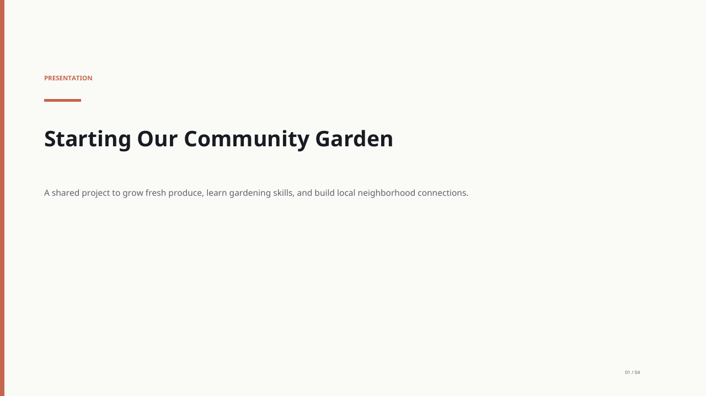
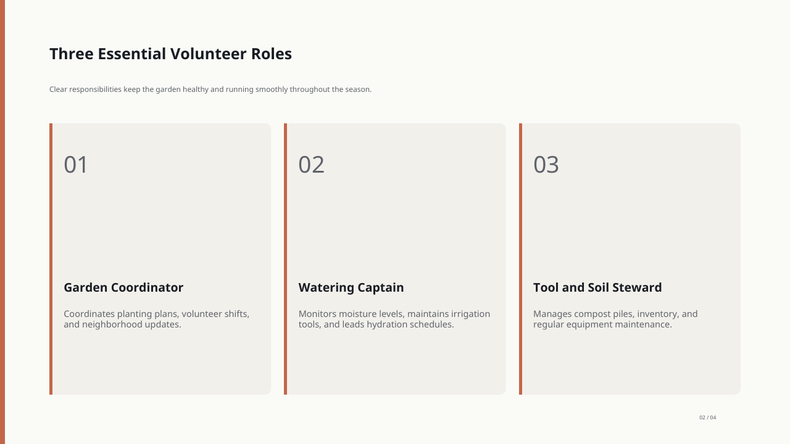
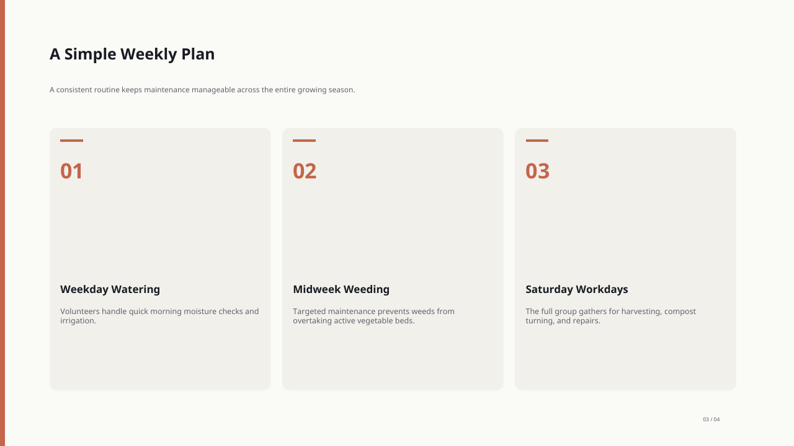
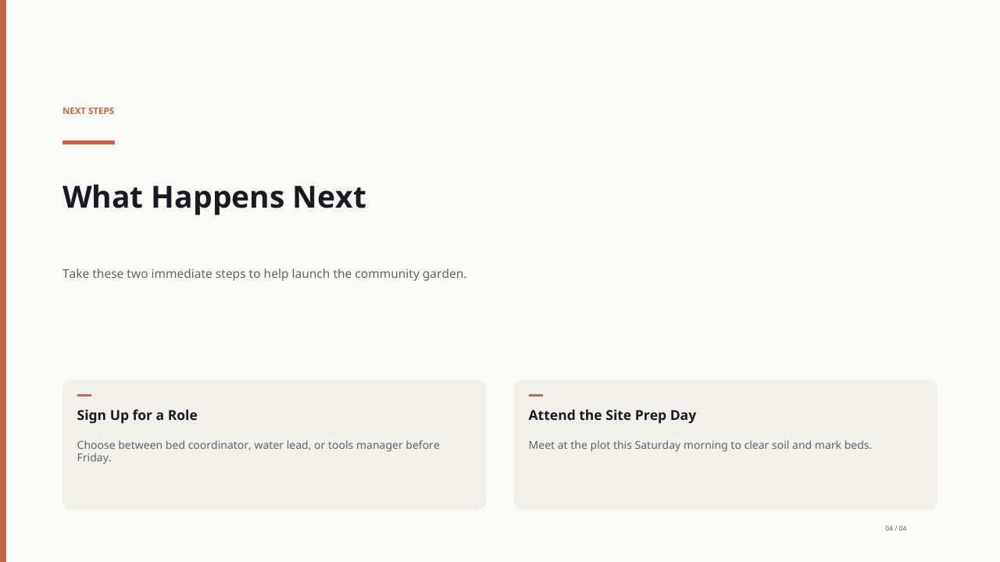

# An actual Brainbaby presentation: PDF and editable PowerPoint

[Download PDF](community-garden.pdf) · [Download PowerPoint](community-garden.pptx) · [Browse the slides in Brainbaby](https://brainbaby.ai/presentation-maker?utm_source=github&utm_medium=referral&utm_campaign=presentation-evaluation-kit#generated-presentation-example)

This is a four-slide English example made in Brainbaby. It was generated on **October 2, 2026**, with one body-text edit saved that day, then reopened and exported on **October 17, 2026**. The export files' creation date is separate from the original generation date. These are the same files published on Brainbaby, not a newly generated demonstration or a customer case study.

## Original request

> Create a four-slide presentation about organizing a small community garden. Cover the goal, three volunteer roles, a simple weekly plan, and next steps. Keep the text concise; do not invent statistics or browse connected apps.

The garden and schedule are fictional. Friday and Saturday references are proposed wording, not confirmed events. Replace them before using the example for a real group. This small example does not prove factual accuracy or equivalent results for another topic.

## Inspect the four slides

These previews show the PDF export. PowerPoint layout can differ in your editor.

### 1. Starting Our Community Garden

### 2. Three Essential Volunteer Roles

### 3. A Simple Weekly Plan

### 4. What Happens Next

## Review the files in your own editor

- Open the PDF to inspect the fixed layout, contrast and line wrapping.
- Open the PowerPoint file and try changing a heading and one body-text line. Its slide text is stored as native PowerPoint text, but rendering and editability should be checked in your chosen application.
- Compare the exported deck with the original request. Record missing details and unintended changes, not just the appearance of the first slide.
- Use the [comparison worksheet](../../../resources/en/presentation-tool-comparison-worksheet.md) and [blank scorecard](../../../resources/en/presentation-tool-scorecard.csv) for a separate six-slide exercise. Those files contain no scores or preselected winner; the retail exercise is not the garden example shown here.

[presentation-example-manifest.json](../../../presentation-example-manifest.json) records the published source URLs, file sizes and SHA-256 checksums. The paths inside [provenance.json](provenance.json) refer to the Brainbaby website; the files are mirrored in this folder without changing their bytes.

## Plan your own presentation

The [free presentation planner](https://brainbaby.ai/presentation-maker?utm_source=github&utm_medium=referral&utm_campaign=presentation-evaluation-kit#presentation-planner) lets you prepare a topic, audience, decision and source notes. Preparing an outline does not generate a deck. Sign in and review your account allowance and the displayed quote before generating your own presentation. [Current plans](https://brainbaby.ai/pricing?return_to=presentations&utm_source=github&utm_medium=referral&utm_campaign=presentation-evaluation-kit) show monthly and regional options.

For work with a client, start from the [sales-proposal outline](https://brainbaby.ai/presentation-templates/sales-proposal?utm_source=github&utm_medium=referral&utm_campaign=presentation-evaluation-kit). Review the facts, agreed scope and terms before using a draft.

## License scope

The library's CC BY 4.0 license applies to the planning worksheet and blank scorecard. It does **not** grant rights to Brainbaby trademarks or this generated deck and its previews. These example files are published for inspection; the service's [terms](https://brainbaby.ai/terms) remain separate. Do not add confidential source material, customer information or payment receipts to public reviews.
